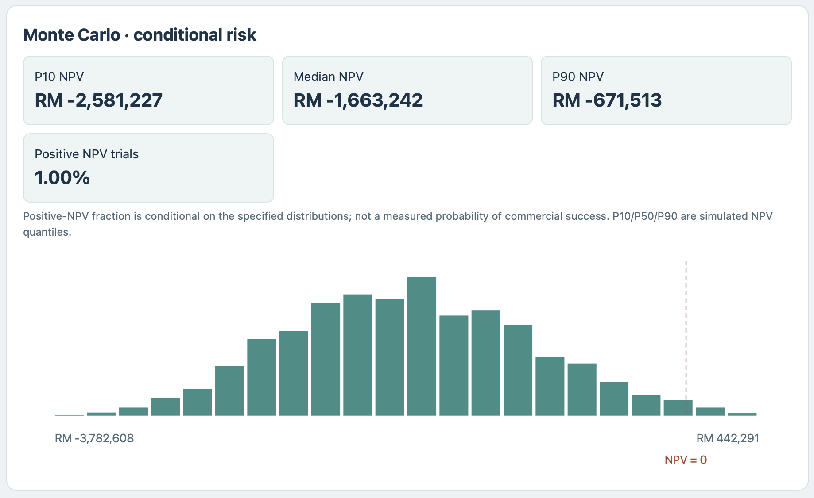
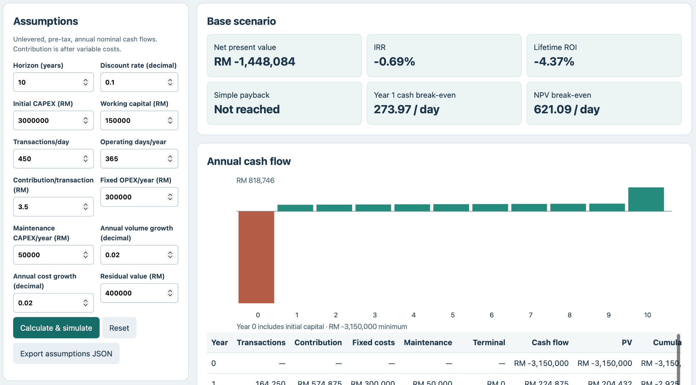
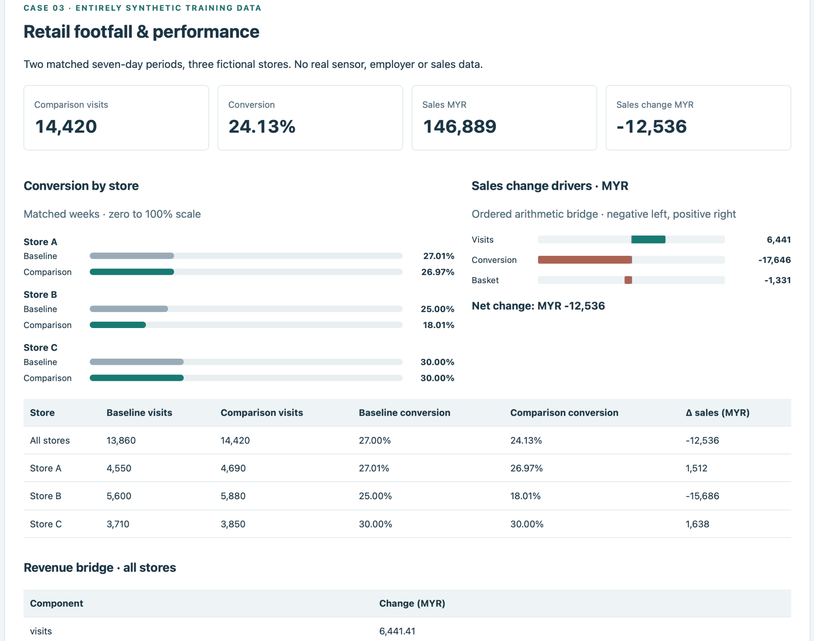
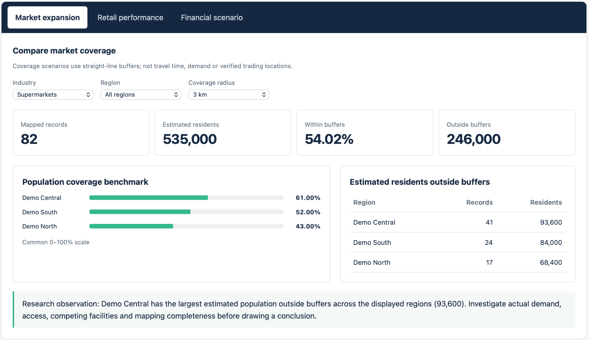
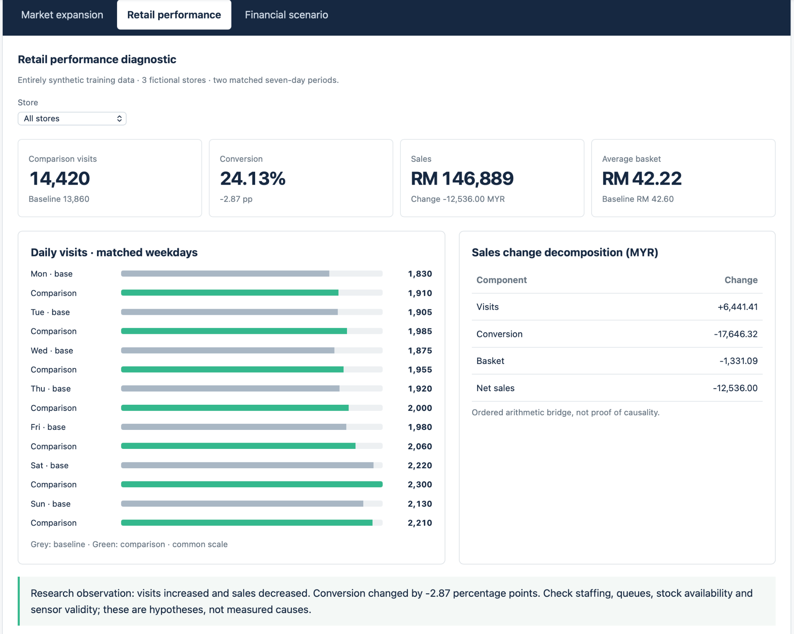
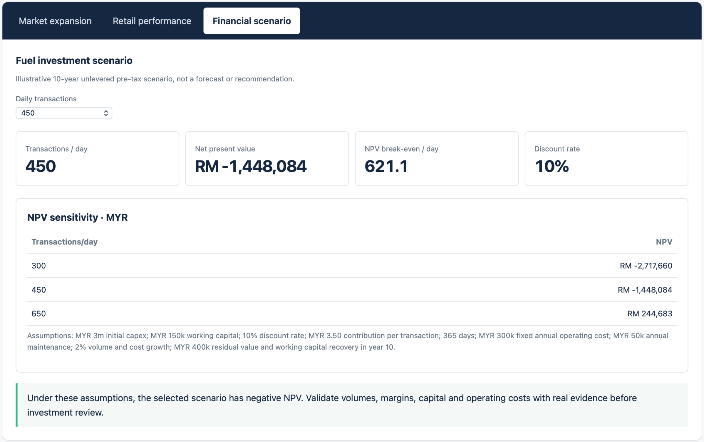
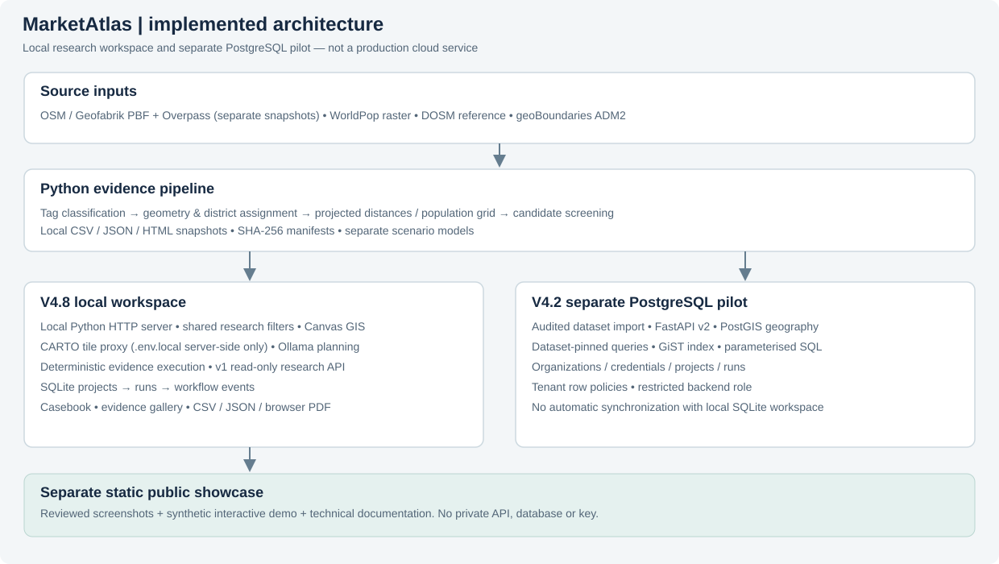
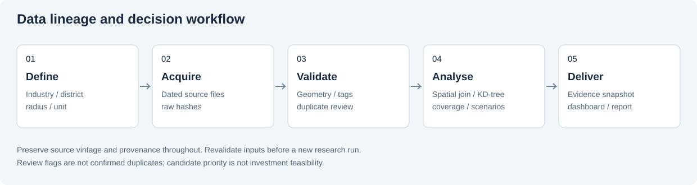
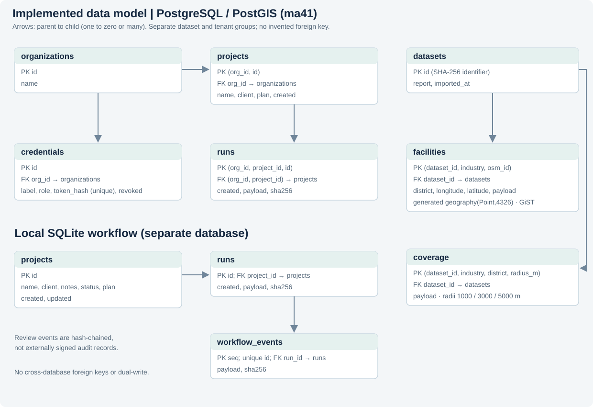

# MarketAtlas Intelligence

**Geospatial business intelligence & decision support | Guang Quan Tan**

> Public starter: actual screenshots of synthetic training data and illustrative finance only. Historical figures below describe the separate local project.

[Interactive demo (after deployment)](https://williamtangq.github.io/MarketAtlas-Showcase/demo.html) · [Showcase website (after deployment)](https://williamtangq.github.io/MarketAtlas-Showcase/) · [Technical architecture & ERD](TECHNICAL.md) · [Contact me on LinkedIn](https://www.linkedin.com/in/williamtangq/)

The implementation repository is private. This showcase is deliberately separate; it contains presentation assets and a standalone synthetic demo, not the full Python/SQL application, private databases or secrets. Contact me for a walkthrough or discussion of source access.

## Why I built it

During a conversation with a senior HR professional, I was asked a practical question: if a company wanted to know how many petrol stations were in a specific area, how would I find out? I turned that question into an independent, AI-assisted Business Information Systems portfolio project: define the geography, obtain evidence, validate it, analyse it and communicate the result.

> How would you find out how many petrol stations are in a specific area?

Rather than simply search Google Maps, I wanted to define a reproducible research process: a measurable business question, reliable data acquisition, clear statistical scope, spatial analysis, validation and decision communication.

## Project at a glance

| Scope | Historical implementation result |
|---|---:|
| Facility–industry memberships | 4,648 |
| Distinct OSM objects | 4,644 |
| Industries | 10 |
| Johor districts | 10 |
| Road representative points | 4,257 |
| Industry × candidate × radius combinations | 127,710 |
| Coverage metric rows | 330 (districts + statewide) |
| Business case studies | 3 (hypothetical briefs) |

The latest V4.8.1 development suite previously reported 364 passing automated tests; this is not a claim of production reliability or complete manual UAT. The historical metrics are mapped/modelled observations, not a verified operating-business census.

## Product evidence — original screenshots

Every image below is an original capture of a running application or explicitly identified external map. Click to inspect the full-resolution image. No AI-generated UI previews are used. The data type is labelled independently of screenshot authenticity.

### Monte Carlo conditional risk

**Illustrative financial assumptions** — Actual model output using illustrative input distributions: median NPV MYR −1,663,242; positive NPV trials 1.00%. Not a measured probability of commercial success.

### Investment feasibility and cash flow

**Illustrative financial assumptions** — Actual model output under illustrative assumptions: NPV MYR −1,448,084, IRR −0.69%, NPV break-even 621.09 transactions/day. Not a real investment forecast.

### Retail footfall and performance

**Synthetic training data** — Actual casebook output from entirely synthetic training data: three fictional stores, two matched weeks, 14,420 visits, 24.13% conversion and MYR −12,536 sales change. No real sensor, employer or sales data.

### Interactive market expansion

**Synthetic market demo** — Actual interactive demo capture: 82 mapped-record equivalents and 54.02% modelled coverage in fictional Demo Central, Demo South and Demo North. All market inputs are synthetic; these are not Johor observations or evidence of demand.

[Try this interactive analysis (after deployment)](https://williamtangq.github.io/MarketAtlas-Showcase/demo.html#market)

### Interactive retail performance

**Synthetic training data** — Actual interactive demo capture with synthetic store data: visits, conversion, average basket, and the ordered arithmetic sales change bridge. The bridge is not proof of causality.

[Try this interactive analysis (after deployment)](https://williamtangq.github.io/MarketAtlas-Showcase/demo.html#retail)

### Interactive financial scenario

**Illustrative financial assumptions** — Actual interactive scenario output: 450 transactions/day, NPV MYR −1,448,084 and NPV break-even 621.1 transactions/day. Illustrative 10-year unlevered pre-tax assumptions, not a forecast or recommendation.

[Try this interactive analysis (after deployment)](https://williamtangq.github.io/MarketAtlas-Showcase/demo.html#finance)

## Business cases and decision framing

| Case | Finding | Recommended research action |
|---|---|---|
| Petrol station expansion | 596 mapped PBF fuel objects; 80.93% modelled residential coverage at 3 km; Batu Pahat has 178,085 estimated residents outside buffers | Validate operating stations, access, traffic and costs before field research |
| Retail expansion | 400 mapped supermarket objects; 76.78% modelled coverage; Kota Tinggi has 173,541 estimated residents outside buffers | Compare absolute gaps with coverage rates; validate actual demand and competition |
| Retail performance | Synthetic matched weeks: 14,420 visits, 24.13% conversion, MYR 146,889 sales; sales fell MYR 12,536 | Investigate Store B and test staffing, queue, stock and sensor hypotheses |

No real client engagement, observed retail sales or investment outcome is claimed. The financial example is an illustrative 10-year unlevered pre-tax NPV scenario, not a forecast.

## Data acquisition and methodology

| Source | Purpose |
|---|---|
| [OpenStreetMap / Geofabrik](https://www.openstreetmap.org/copyright) | OSM PBF snapshot 2026-11-24T21:21:23Z; selected exact sector tags; node/way/area-relation objects. Earlier fuel-specific analysis used a separate Overpass snapshot. |
| [Geofabrik](https://download.geofabrik.de/asia/malaysia-singapore-brunei.html) | Malaysia–Singapore–Brunei extract; selected road classes for road samples and mapped facility extraction. |
| [WorldPop](https://hub.worldpop.org/geodata/summary?id=74272) | 2026 R2025A v1 alpha constrained ~100 m modelled population grid; positive pixel centres assigned to districts and projected for distance. |
| [DOSM](https://open.dosm.gov.my/) | 2026 district population reference; separate from WorldPop; not used to rescale the raster. |
| [geoBoundaries](https://www.geoboundaries.org/) | Malaysia ADM2 administrative boundaries; boundary membership and clipping. |
| [CARTO Voyager](https://carto.com/attribution/) | Display-only basemap; local proxy sends tile requests; not the source of facility counts. |

WorldPop DOI: [10.5258/SOTON/WP00839](https://doi.org/10.5258/SOTON/WP00839). Map credits: [© OpenStreetMap contributors](https://www.openstreetmap.org/copyright) · [© CARTO](https://carto.com/attribution/). Source-specific terms apply.

The counts represent mapped OSM objects or facility–industry memberships, not a verified census of operating businesses. Population is modelled, not observed demand. Coverage uses straight-line buffers, not travel time. Candidate points are road samples, not available land. The client briefs are hypothetical; the retail operating data are synthetic and the financial results are illustrative. No commercial deployment, client outcome or realised savings are claimed.

## System architecture, data flow and ERD

Python, GIS, JavaScript/HTML/CSS, SQLite, PostgreSQL/PostGIS, FastAPI, SQL, local Ollama, and CARTO Voyager (local map proxy). The main workspace uses SQLite and file-based snapshots; the PostgreSQL/FastAPI pilot is a separate service. No production hosting or automatic cross-database synchronization is claimed. [Full technical notes](TECHNICAL.md).

## Applied Business Information Systems knowledge

| Capability | Application | Knowledge area |
|---|---|---|
| Business requirements & stakeholder analysis | Define business question, scope, acceptance criteria, user stories, assumptions and decision brief. | Systems development / Business Information Systems |
| Database design & SQL | Entity relationships, primary/foreign keys, composite dataset grain, GROUP BY, JOIN, CTE and spatial SQL. | Database studies |
| Data analysis & decision modelling | Coverage, density, population gaps, NPV/IRR, sensitivity and Monte Carlo scenarios. | Business decision modelling |
| Systems integration & architecture | Separate local workspace and tenant API; REST JSON, role restrictions, evidence provenance and export. | Information systems / integration concepts |
| UX & data visualisation | Map layers, linked filters, benchmark bars, responsive dashboard, task-focused workflow. | Usability and interface design |
| Quality assurance & governance | Duplicate-review queue, checksum verification, automated tests, UAT plan, review and release events. | Systems development / professional practice |
| Programming & automation | Python extraction, cleaning and calculations; JavaScript/CSS interface; repeatable builds. | Programming and web fundamentals |

## My contribution and AI assistance

I originated the project from the interview question, set the research direction and requirements, refined the UI and evidence presentation, ran the application locally, tested outputs and supplied actual screenshots. AI tools assisted with coding, debugging, test generation and documentation. I am developing independent proficiency in the analytical and technical methods and can demonstrate my practised work in a walkthrough. I do not claim sole unaided implementation or actual client results.

## Access and contact

The full implementation remains private. I am happy to discuss the problem, decisions, methodology and a live local demonstration, or consider appropriate access on request.

**Guang Quan Tan** — [LinkedIn](https://www.linkedin.com/in/williamtangq/)
