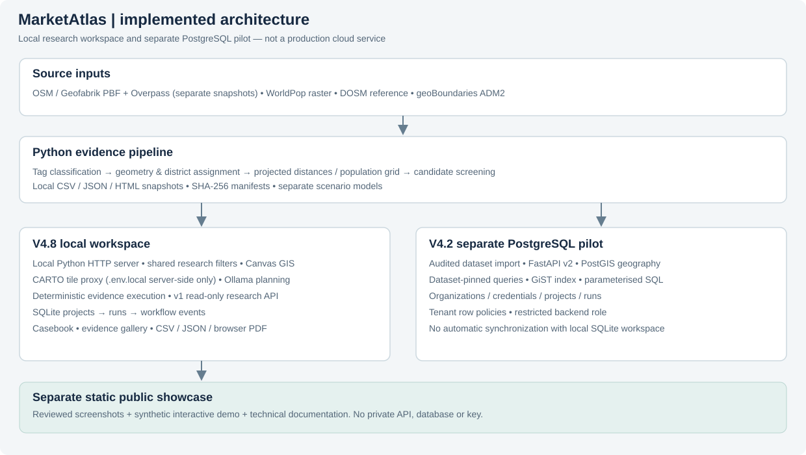
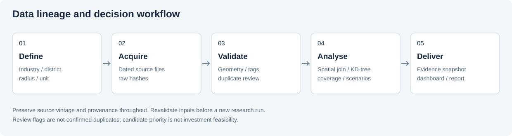
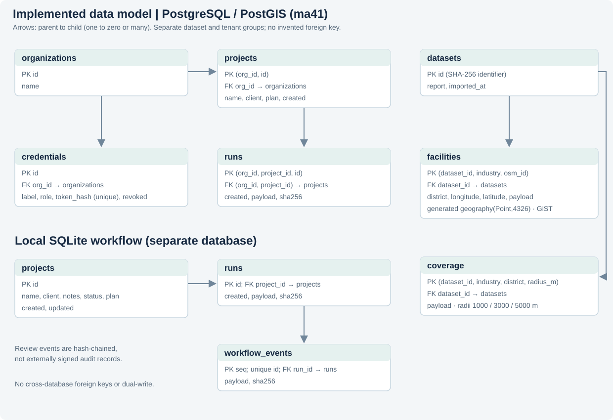

# Technical architecture and methodology

[Public workspace](https://williamtangq.github.io/MarketAtlas-Showcase/) · [Interactive demo](https://williamtangq.github.io/MarketAtlas-Showcase/demo.html) · [Project README](README.md)

This is an implemented local prototype, not a hosted production SaaS. Diagrams are documentation based on the shipped source, not product screenshots.







## Data model and grain

| Table / record | Grain and role |
|---|---|
| `ma41.datasets` | one audited imported dataset ID |
| `ma41.facilities` | dataset × industry × OSM object; composite PK; generated geography(Point,4326) and GiST spatial index |
| `ma41.coverage` | dataset × industry × district × radius; composite PK |
| `ma41.organizations` / `credentials` | organization and credential records; role, token hash, revocation; raw tokens not stored in table |
| `ma41.projects` / `runs` | organization-scoped projects and research snapshots; composite foreign key |
| SQLite `projects` / `runs` / `workflow_events` | independent local workspace research and hash-chained workflow events |
| Synthetic retail CSV | date × fictional store; matched seven-day periods |
| Illustrative financial CSV | daily transaction volume scenario; not an observed investment |

The PostgreSQL dataset and tenant entities do not have a direct dataset-to-run FK in this schema. Provenance is captured through application payloads. Local SQLite review history is not synchronized with PostgreSQL. The trusted backend role sets tenant context; row-level security is not a substitute for a production identity provider, penetration test or public deployment.

## Analysis logic

- Count distinct OSM identifiers within a defined industry/district scope. An object may appear under multiple sectors; compare membership count with distinct objects. Separate node and area representations may still represent the same physical store.
- Tag matching and spatial boundary assignment: classify, project into EPSG:32648 for local distance calculations, validate and exclude ambiguous geometry. Use projected pixel centres for WorldPop estimates. Do not use masked cells as zero population.
- Residential coverage: covered positive-pixel estimated population / total estimated population in the chosen district and radius. Include mapped facilities across district boundaries; exclude facilities outside Johor. Recalculate from totals, not average district percentages. The separate PostGIS nearby query uses geography distance; not driving time.
- Road sample screening: 4,257 representative points × 10 sectors × 3 radii = 127,710 analytical combinations; only five residential-service sectors receive ranks in V3.7. Rank by uncovered estimated residents; shortlist spacing limits clustering. Not land availability, traffic, measured demand or forecast.
- Retail: total transactions / total visits; sales = visits × conversion × average transaction value. Ordered arithmetic bridge changes visits, then conversion, then basket. Not causal attribution.
- Finance: discounted unlevered pre-tax cash flows, volume scenarios, break-even and conditional Monte Carlo simulations using specified assumed input distributions. Not a probability of real success.
- AI: local Ollama converts supported research questions into constrained tool plans; validated execution reads deterministic evidence and returns sources/limitations. It does not infer actual sales or freely query arbitrary databases.
- Governance: source and output checksums, independent manual data-quality tasks, saved immutable-by-application snapshots and review event chain. Hashes detect changes against pinned values, not malicious tampering by an administrator who can rewrite all records.

## SQL illustration (read-only, parameterized)

The following query is a teaching example based on actual schema names; use a bound dataset parameter through the trusted local SQL practice script, not production credentials:

```sql
SELECT district, COUNT(*) AS mapped_objects
FROM ma41.facilities
WHERE dataset_id = %s AND industry = %s
GROUP BY district
ORDER BY mapped_objects DESC;
```

To include districts with no mapped objects, start with the coverage rows for the chosen radius and LEFT JOIN the grouped counts, matching dataset, industry and district. Verify that district counts reconcile to the statewide scope. PostGIS `ST_DWithin(location, point::geography, metres)` measures geodesic distance for nearby-facility queries; it does not use a road network.

## Source and attribution
- [OpenStreetMap / Geofabrik](https://www.openstreetmap.org/copyright) — OSM PBF snapshot 2026-11-24T21:21:23Z; selected exact sector tags; node/way/area-relation objects. Earlier fuel-specific analysis used a separate Overpass snapshot.
- [Geofabrik](https://download.geofabrik.de/asia/malaysia-singapore-brunei.html) — Malaysia–Singapore–Brunei extract; selected road classes for road samples and mapped facility extraction.
- [WorldPop](https://hub.worldpop.org/geodata/summary?id=74272) — 2026 R2025A v1 alpha constrained ~100 m modelled population grid; positive pixel centres assigned to districts and projected for distance.
- [DOSM](https://open.dosm.gov.my/) — 2026 district population reference; separate from WorldPop; not used to rescale the raster.
- [geoBoundaries](https://www.geoboundaries.org/) — Malaysia ADM2 administrative boundaries; boundary membership and clipping.
- [CARTO Voyager](https://carto.com/attribution/) — Display-only basemap; local proxy sends tile requests; not the source of facility counts.

WorldPop dataset DOI: https://doi.org/10.5258/SOTON/WP00839. Check source-specific licence and redistribution requirements before sharing any derived data. [CARTO terms](https://carto.com/legal/basemap-terms/) allow static illustrative/editorial/documentary screenshots with legible attribution; this does not independently clear overlay datasets or every use case. [OSM attribution guidance](https://osmfoundation.org/wiki/Licence/Attribution_Guidelines). No raw datasets or credentials distributed here.
